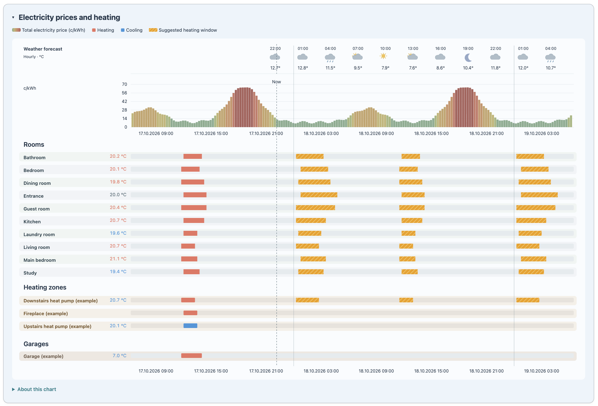
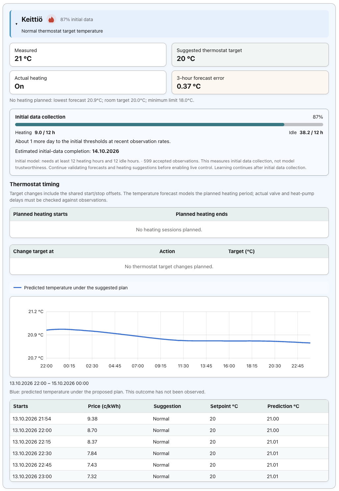
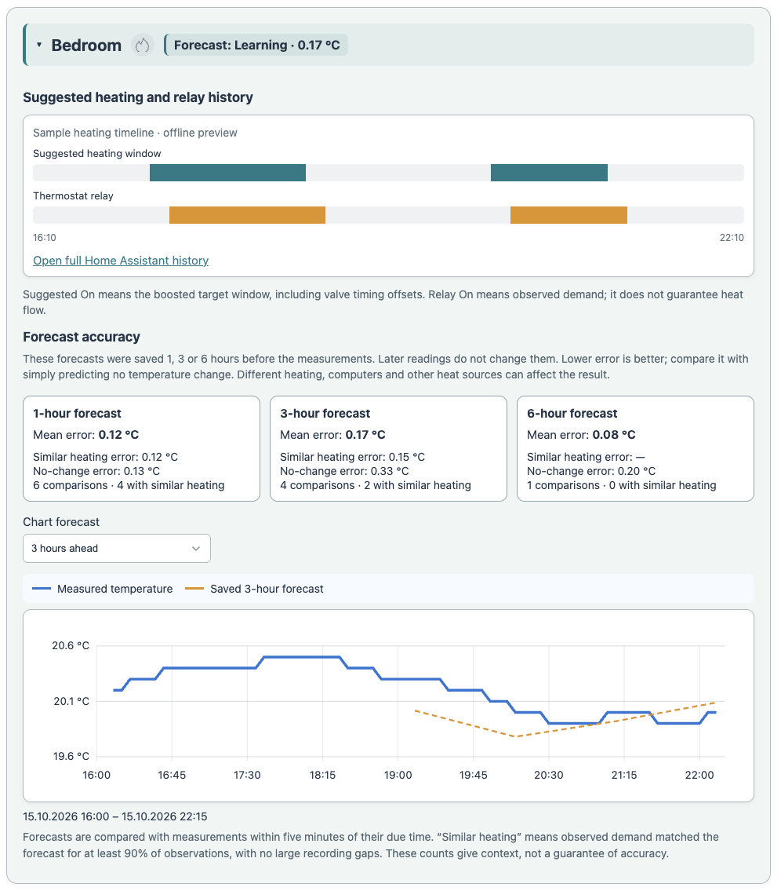
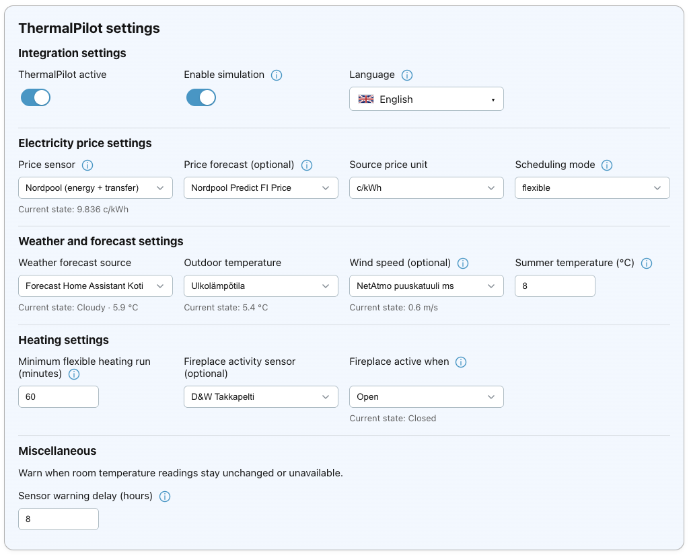
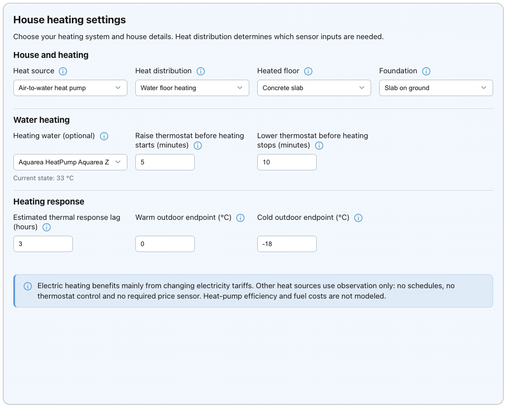
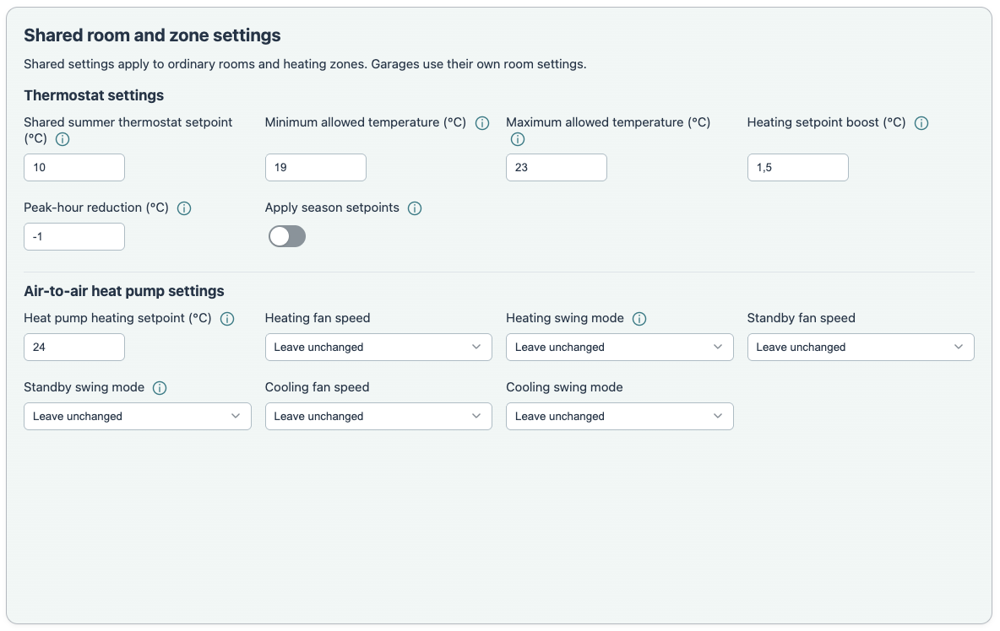
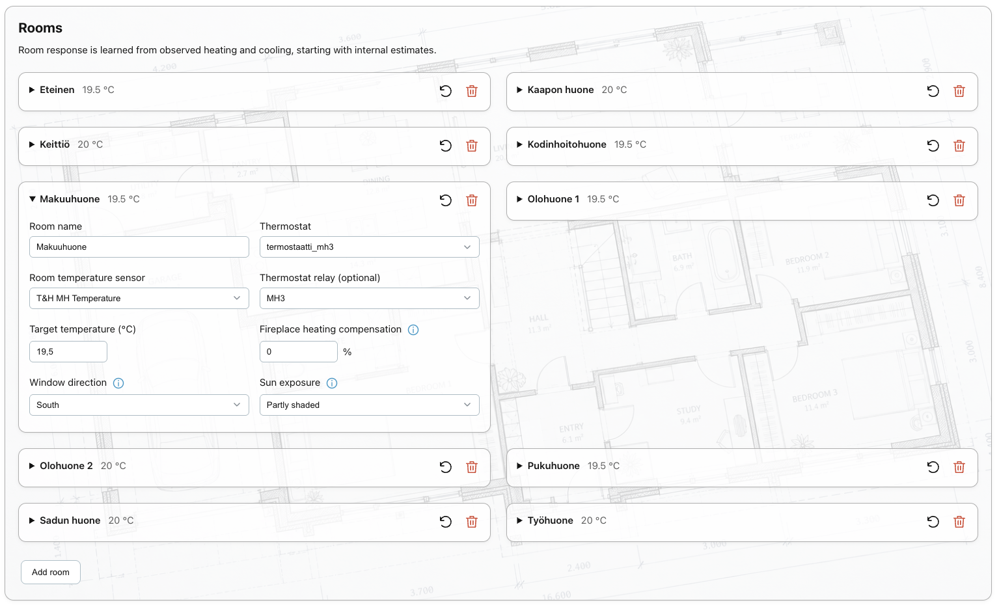

**Use ThermalPilot at your own risk; it is provided without warranty, and, to the fullest extent permitted by applicable law, its author and contributors accept no liability for additional energy costs, equipment damage, heating failures or other losses resulting from its use.**

# ThermalPilot

**ThermalPilot is primarily useful for heat pumps and electric resistance heating
with a changing electricity tariff**, such as hourly or quarter-hour spot prices.
Its main purpose is to shift heating toward cheaper periods while maintaining
comfort. With a fixed electricity tariff, there is little tariff-shifting benefit.
Rooms using gas, oil, wood/pellet or district heating provide temperature history
and thermal-response learning without fuel-cost scheduling or thermostat control.
Independent electric garage rooms and air-to-air zones can still use their own
controllers alongside those house systems. Garage temperature-only cycling also
works without an electricity-price sensor.

Version **0.9.4 — experimental simulation-first Home Assistant custom integration**.


## Screenshots

Examples from a configured installation. Room names, selected sensors and values
shown here are examples, not preset defaults.



<details>
<summary>Room plan and forecast accuracy</summary>

### Room plan



### Room history



</details>

<details>
<summary>Settings</summary>

### Integration settings



### House heating settings



### Shared room settings



### Rooms



</details>

**Start in simulation and allow time for learning and validation.** Initial data
collection reaches 100% after at least 12 observed heating hours and 12 idle
hours; that is a minimum evidence threshold, not proof of reliable heating
plans. Useful validation may take weeks or months, especially in mild weather
with little heating. There is no fixed one-to-two-month deadline, automatic
activation or guaranteed date when simulation can safely stop. Learning
continues after initial collection.

Review saved multi-hour forecasts against actual measurements and the no-change
benchmark, including periods where actual heating matched the proposed plan.
Also inspect heating schedules across heating/idle cycles, cold weather and
changes in sun or wind. A small error during stable temperatures alone does not
validate heating capacity, timing or live control.

ThermalPilot is an experimental **general-purpose heating integration for Home Assistant**. It learns room thermal response and plans thermostat targets using weather, comfort limits and electricity prices. Development and validation began with a Panasonic Aquarea T-CAP air-to-water heat pump and water floor heating in a concrete slab; that configuration remains the backward-compatible default.

Distribution-aware inputs support water floor/radiator systems and electric floor, ceiling/panels or warm-air systems controlled through room thermostat targets. Electric and air distribution use observed demand with a unit heating factor rather than requiring water temperature. This is a common empirical response model, not a complete equipment-specific simulation. Heat-source details list gas, oil, wood/pellet boilers and district heat, but their fuel costs and equipment-specific controls are not implemented. Mixed systems currently retain water controls; per-room distribution overrides are not yet supported. Heat-pump COP, defrost and manufacturer-specific operating limits are not modeled.

ThermalPilot is installed through HACS as a custom integration. Its Home Assistant
manifest uses `integration_type: service`, representing one heating-planning
service per configuration entry. This classification follows the
[Home Assistant manifest documentation](https://developers.home-assistant.io/docs/creating_integration_manifest/#integration-type).

## What this version includes

- A dedicated **ThermalPilot** sidebar panel with **Plan**, **History**
  and **Settings** pages, available in **25 languages**. English is the default;
  the language can be changed in Settings.
- Room names, thermostats, temperature sensors and actual heating-activity sources.
- Automatic detection of source price intervals: timestamped rows are preferred;
  plain lists use 24 hourly or 96 quarter-hour prices per regular day.
- Internal hourly averaging of quarter-hour prices.
- Hourly, quarter-hour and flexible-run planning. Flexible runs start/end on
  quarter-hour boundaries and have a configurable minimum length, default 60 minutes.
  Runs can last 75, 90, 105 minutes, etc.; they are not rounded to whole hours.
- Final-price sensor input including all variable electricity costs.
  Grid charges may include electricity tax.
- Rolling planning across midnight, including bridging heating before predicted
  cooling and a terminal reserve beyond the end of published prices.
- Per-room target and comfort limits, with a separate **Shared room settings**
  section for boost/reduction, thermal lag, curve endpoints and supply water.
- Conservative online adaptation using actual heating activity and temperature changes.
- Five-minute SQLite observation history and native HA suggested-heating
  binary sensors and suggested-setpoint/forecast/error sensors.
- One Active/Passive master switch for planning, collection and learning.
- Active/Passive collection, full-season accumulators, compact
  season archives and retained learned parameters for the following season.
- A **shared summer setpoint**, default 10 C, and optional actual season setpoint
  application. Scheduled heating decisions always remain simulated in version 0.1.

For water-based distribution, a heating-water source is optional. Valid readings
adjust estimated heating output. Without a sensor or while it is unavailable,
planning and learning continue using observed thermostat demand with no water-temperature adjustment. Select the source under **Settings → House heating settings → Water heating →
Heating water (optional)**. It accepts temperature sensors or climate entities
with a `current_temperature` attribute from your own Home Assistant installation.
This reads measured water temperature, not the climate target. A fixed internal
32 °C reference calibrates the model and never commands the heat pump. Starting heating-hour
estimates are internal model seeds. Each room has a target temperature; minimum
and maximum allowed temperatures are shared across the house. Learning collects
valid observations automatically while active collection is enabled.

A shared **Enable simulation** toggle selects simulated or real scheduled control
for every room. Disabling it and confirming activates thermostat target control.
If another automation controls the same thermostats, disable it before enabling
ThermalPilot live control. No existing heating automation is required. Observation
and learning continue in both modes while ThermalPilot is Active. Initial-data percentages
do not prove model reliability and do not automatically activate control.

Planning automatically covers all continuously available price intervals from
now until the published prices end. There is no configurable planning horizon,
and missing future prices are not invented.

Weather forecasts are selected automatically: hourly first, then twice daily,
then daily, depending on usable data from the selected weather source.
Forecasts refresh hourly; changing the source refreshes immediately.

## Room sensor checks

While Active, ThermalPilot checks whether each room's temperature reading has
changed. After the configured unchanged temperature interval (default eight hours) of unchanged or unavailable readings, one persistent
Home Assistant notification lists the suspect rooms. Stable room temperatures
can produce this warning too; it identifies a possible issue rather than a
confirmed sensor failure. A changed reading resets the timer.

Notifications are limited to once per local calendar day, including across
restarts. Passive mode resets observation timers; monitoring resumes on activation.
A monitoring gap longer than 30 minutes also restarts the sensor-warning observation
period. The notification ID is reused so unresolved alerts do not accumulate.

## Native Home Assistant heating timelines

Each room on History has a native Home Assistant history-graph card comparing
its recorded suggested-heating window with the selected thermostat relay.
Without a relay selection, a ThermalPilot binary sensor publishes observed
thermostat demand at the observation interval. The relay's own entity provides
its directly recorded state transitions. Entity registry lookup supports renamed
suggestion entities without guessing their IDs.

These graphs use Home Assistant Recorder history rather than ThermalPilot's
SQLite retention. Both entities must be recorded; excluded entities and periods
before installation have no recorded history. If dashboard card helpers have not
loaded, open a Home Assistant dashboard once and return, or use the provided full
History link. Future suggested sessions remain on Plan; these timelines show
previously published suggestions and observed demand.

## Reading room history

Room charts have a legend: blue is measured temperature; the dashed orange line
is the selected saved 1-, 3- or 6-hour forecast under the proposed heating plan.
Actual heating differences are reported separately in the accuracy cards. Both lines are
included in the temperature-axis scale. Short views use quarter-hour time labels.

History tables show the latest observation in each 15-minute interval. Suggested
heating-window On/Off describes the proposed boosted-target window; actual
thermostat-demand On/Off describes the observed relay or thermostat request. These
can differ, and neither proves heat flow. Missing observations show Unknown.
The suggested thermostat target is the proposed setpoint, not a room-temperature
forecast. Original observations retain their resolution in the local database.

## Entity selection

Temperature fields show temperature sensors, including template sensors with
temperature units and no device class. Electrical power fields show power sensors
in W/kW rather than energy counters. Price sources must expose `today`, `tomorrow`,
`raw_today` or `raw_tomorrow` list attributes. Thermostat relay selectors accept only switch entities with on/off states.
An empty relay source falls back to the thermostat hvac_action attribute.
Weather and thermostat fields are restricted to their respective entity domains.

Already configured sources remain visible if unavailable or no longer matching
the filter, with an explanatory label. They are never silently cleared.

## Thermostat timing offsets

Under **Shared room settings**, configure how many minutes before a heating
session the thermostat target should rise and how many minutes before its end
it should fall. Defaults are 5 minutes before start and 10 minutes before stop.
For a 22:00–23:00 session, the suggested target rises at 21:55 and falls at 22:50.
Both offsets accept whole minutes from 0 to 30, including values outside the
15-minute price boundaries. Consecutive heating slots form one session. Once a
published session reaches its advance valve-opening time, subsequent calculations
retain that session through its planned delivery end. Its original start time is
preserved so valve offsets are not reapplied to the clipped remaining period.
This continuity applies while the integration runs with valid inputs; disabling
operation, changing settings, missing required inputs, or restarting can interrupt it.
A restart recomputes the current plan from available inputs rather than replaying old commands.
While Home Assistant is offline, ThermalPilot cannot send commands; thermostats
normally retain their last target and continue their own local regulation.
On startup, confirmed live control sends each available thermostat its newly
calculated current target once, even if Home Assistant's restored target attribute
already matches. Missed commands are not replayed. If essential sources have not
returned, seasonal comfort fallback targets are used instead. Source recovery
triggers a new calculation, normally after a five-second debounce; unavailable
thermostats are retried when they return and on regular updates. Downtime is not
counted as observed heating or cooling, and estimated slab response is reset.

The Plan page shows intended heating periods and the offset-adjusted thermostat
commands separately. Suggested-state entities update at command boundaries
without waiting for the next five-minute planning/learning cycle. In simulation
mode these outputs do not operate thermostats. In confirmed live mode the same
boundaries apply the thermostat targets, including the shared valve timing offsets.
The temperature forecast assumes intended heat-delivery periods; advance timing
is not a measured model of valve travel or pump shutdown and cannot guarantee
that all energy use stops before a higher tariff.

## Important operating distinction

**Default: simulation only.** No physical thermostat or heat-pump commands are sent.
Your thermostats continue operating under their current settings and controls.

**Live control is opt-in.** Turn off Enable simulation, save and confirm. If
another automation controls the same thermostats, disable it first to avoid
conflicting commands. Existing installations with a
legacy simulation-off preference do not silently activate control: explicit
confirmation is required. Returning to simulation releases controlled thermostats
at their seasonal fallback temperatures. Ordinary thermostat control uses Home Assistant’s `climate.set_temperature` action.
Explicit air-to-air rooms and heating zones additionally use `set_hvac_mode`,
`set_fan_mode`, and a selected `set_swing_mode`. Only advertised device modes are
accepted. Pauses use **fan-only**, rather than switching the pump off. Garage
warm-weather operation can switch it off as described below. Relays are observed,
not operated directly.

Missing essential inputs or an expired plan returns affected rooms to seasonal
fallback temperatures. Turning ThermalPilot active off cancels the scheduled
commands and applies the same fallback, without collecting new room observations:

- Summer: the shared summer thermostat setpoint.
- Winter: each room's normal target temperature.
- 15 May through 30 September is always summer. Outside those dates, a complete
  day's minimum forecast temperature equal to or above Summer temperature (default
  6°C) also selects summer. Lower readings already observed that day are retained.
  Unknown/incomplete daily coverage outside the summer dates selects winter.

The threshold is configurable under Weather and forecast settings. Hourly
forecasts need coverage across the full local day; complete daily forecasts can
also establish the minimum. Daily evidence survives restarts. Calendar summer
requires no forecast. Failed thermostat writes are reported and retried; duplicate
writes awaiting state acknowledgement are suppressed briefly. Device temperature
limits and target steps are respected. Source changes trigger a debounced refresh
instead of always waiting for the five-minute poll.

The optional **Apply season setpoints** setting also allows real thermostat writes
in simulation: Active sets normal room targets, while Passive applies seasonal
fallback. Keep it disabled for a completely read-only trial. In live mode the
scheduled controller handles targets, so the two paths do not compete.

## Installation through HACS

1. Open HACS and its **Custom repositories** dialog.
2. Add `https://github.com/jvuotila/ThermalPilot` with category **Integration**.
3. Find **ThermalPilot** in HACS and download it.
4. Restart Home Assistant.
5. Go to **Settings > Devices & services > Add integration > ThermalPilot**.
6. Select the price and outdoor-temperature sources, then configure rooms and
   all other settings in the **ThermalPilot** sidebar panel.

This is a Home Assistant custom integration distributed through HACS.
It does not require creating a Home Assistant helper to install it.

## Alternative: local package

1. Unzip the distribution.
2. Copy `custom_components/thermal_pilot` into your Home Assistant configuration
   directory's `custom_components` directory.
3. Restart Home Assistant.
4. Go to **Settings > Devices & services > Add integration > ThermalPilot**.
5. Select the price sensor and outdoor-temperature sensor.
6. Open **ThermalPilot** in the sidebar, then **Settings**.
7. Configure all sources, price handling and rooms, and save.

If the integration does not appear after a restart, inspect Home Assistant's logs
and reload the browser. This package has not been run against your HA installation.
The local test environment does not contain the full Home Assistant runtime.

## Publication and validation

The repository layout and `hacs.json` are included. HACS custom integrations are
installed from a GitHub repository, not directly from this local ZIP file.

Before publication:

1. Run HACS validation and Home Assistant hassfest against
   [jvuotila/ThermalPilot](https://github.com/jvuotila/ThermalPilot).
2. Complete integration tests in an actual Home Assistant environment.
3. Publish a GitHub release after these checks pass.

The repository metadata is configured for `jvuotila/ThermalPilot`.
Listing in the HACS default catalog requires a separate submission.

## Upgrading from the original TermalPilot prototype

Version 0.1.1 corrects the integration name and domain to `thermal_pilot`.
If you already installed the prototype using the `termal_pilot` domain, this
is a replacement installation, not an automatic domain migration:

1. Back up your Home Assistant configuration and record your room/settings values.
   Export observation history from the old panel if you want to retain it.
2. Remove the old TermalPilot integration under **Settings > Devices & services**.
3. Remove `custom_components/termal_pilot` and install
   `custom_components/thermal_pilot` through HACS or the local package.
4. Restart Home Assistant, add **ThermalPilot**, and configure the sources and rooms.
5. Update dashboards/automations that referenced the old simulation entities.

The old learned models and SQLite history are not automatically imported into
the new configuration entry. The new installation starts in simulation mode
with physical season setpoint application disabled. Existing heating automations
continue to run independently. No migration is needed for a fresh installation.

## Starting settings

Select entities from your own Home Assistant installation. ThermalPilot does not
preselect a price, outdoor-temperature or weather entity. Price intervals are
detected automatically from the source lists; there is no Source format setting.

| Setting | Starting value |
| --- | --- |
| Price sensor | Select your own electricity-price entity with complete price lists |
| Source unit | c/kWh by default; change it to match your source |
| Scheduling mode | Flexible |
| Minimum flexible run | 60 minutes |
| Outdoor temperature | Select your own sensor measuring the current outdoor temperature |
| Weather forecast source | Not selected; optionally choose your own weather entity |
| Shared summer setpoint | 10°C |
| Enable simulation | Enabled |
| Apply season setpoints | Disabled |

**Apply season setpoints** is an optional exception to read-only simulation.
When enabled, changing ThermalPilot between Active and Passive can send real
thermostat target commands, even while simulation is enabled. Active applies
normal room targets; Passive applies the summer or winter fallback temperatures.
Leave it disabled if you want simulation to make no thermostat changes. Live
scheduled control is enabled separately by turning off simulation and confirming.

Select a price source whose lists already include VAT, day/night grid charges,
electricity tax and retailer margin. ThermalPilot adds no further costs. The source
can supply complete numeric `today` / `tomorrow` lists or timestamped
`raw_today` / `raw_tomorrow` records with `start`, `end` and `value`.

Set each room's target temperature and shared comfort bounds. All rooms use internal
starting estimates; actual heating and cooling observations refine their models.
Boost and idle adjustment can initially remain +1.5 °C and -1 °C. A three-hour thermal response lag
is an initial estimate; it is configurable and is not automatically learned in v0.1.

Actual heating activity defaults to the selected thermostat's `hvac_action`.
If that attribute is unavailable or does not indicate actual valve demand, choose
a thermostat relay switch instead (on means active). No learning is inferred from a
setpoint alone. Separate valve activity indicates demand, not guaranteed heat flow.

Names and room UUIDs are independent of entity IDs. Removing a room leaves its
historical archive intact. Changes to temperature/activity mapping, lag, curve or
water-reference assumptions reset that room's live learned coefficients.

## Active/Passive and collection

The integration exposes a native HA switch, **ThermalPilot active**.
The same setting can be changed from Plan or Settings.

Use ThermalPilot's own Active/Passive switch to start or end the heating season.

Passive mode stops planning, collection and learning. It preserves learned models
and automatically archives the ending season. On reactivation, existing learned
coefficients remain the starting point; transient slab response is reinitialized.

Collection and learning automatically follow Active/Passive. Missing outdoor
temperature prevents valid observations; there are no automatic season thresholds
or external activation helpers. The planning reserve is an internal six-hour
default, and compaction retains seven days of recent raw observations.

## Data and season compaction

Observations are stored locally at:

`.storage/thermal_pilot.<config_entry_id>.sqlite3`

Model state is stored with HA Store under the same integration/entry namespace.
No external database or cloud service is required.

- At most one stored observation per room per five-minute bucket.
- Raw observation retention: a fixed internal 30-day limit.
- Seasonal accumulators cover all collected samples, including samples whose raw
  rows have already expired. They retain sums, counts, temperature variation,
  observed activity counts, outdoor range and short-term forecast-error statistics.
- On effective Active-to-Passive transition, or optional outdoor-season end,
  compaction archives per-room parameters, recursive-regression sufficient
  statistics, mapping fingerprints and full-season aggregates.
- After compaction, default raw retention is seven recent days; configurable 0–30.
- SQLite `VACUUM` reclaims unused file space at compaction. Routine retention deletes
  reuse pages and do not force expensive daily compaction.
- The archived history is summarized, not a reversible compression of raw samples.
  Full five-minute timelines cannot be reconstructed once expired/compacted.
- Normal next-season startup uses the retained live model state. Archive snapshots
  are also retained for inspection; there is no archive rollback/import UI yet.

A synthetic 10-room, 30-day run stored **86,400 samples in 33,378,304 bytes
(31.83 MiB)**. Keeping only ten model/season archives reduced the test database to
**49,152 bytes (48 KiB)**. Actual size depends on room count and field lengths.
That is roughly 1.06 MiB/day for ten rooms while collecting. The Settings and Plan
pages expose current collection state and Plan shows database size/sample count.
HA Recorder separately stores the integration's entities according to your Recorder
retention policy; these figures cover the integration's SQLite history only.

## Model and planner limitations

See [MODEL.md](docs/MODEL.md) for the equations and assumptions.

- This is an approximate beam-search planner, not a proof of a globally least-cost
  schedule. Each room is planned independently; shared pump capacity, minimum flow,
  compressor cycling, DHW priority and detailed hydraulic coupling are not optimized.
- The model starts from your curve endpoints plus a conservative default heat-loss
  coefficient. A first-order delayed heating response approximates the slab; it is
  not a measured slab temperature or an exact physical energy balance.
- Gain/loss adaptation requires actual activity, bounded time intervals and both
  heating/idle evidence. Fireplace periods are excluded from parameter learning.
- There is no learned lag, automatic heating-system identification or reinforcement
  learning. New heating types need model validation and appropriate assumptions.
- Future water temperature is held at the currently measured/reference value.
  Missing forecast holds outdoor temperature constant and displays a warning.
- Published prices are used only within a continuous known horizon. The model
  estimates a terminal reserve; it does not invent tomorrow's unknown prices.
- Timestamped raw prices support DST. List-only input is rejected on 23/25-hour days
  instead of silently using the wrong tariff or hour.
- Planning cost is normalized to one kW per room. Standing charges do not affect
  scheduling. There is no validated euro savings estimate or room energy metering.
- A shadow simulation cannot measure what would have happened under commands never
  issued. Saved forecasts show outcomes under the proposed plan; heating-match
  counts help separate forecasts with similar demand from those with different heating.

## Development and validation

```sh
python -m unittest discover -s tests -v
python -m compileall -q custom_components
node --check custom_components/thermal_pilot/frontend/panel.js
node tests/test_panel.cjs
```

Tests cover pricing/VAT/tariffs, negative prices, DST, gaps, flexible-run minimums,
a long cross-day gap, learning evidence, retention, seasonal compaction, passive
mode, optional season commands and failed-command retries. HA adapter tests use
minimal doubles; they do **not** replace full HA integration tests.

`PREVIEW.html` is an offline sample interface with invented data and mock storage.
It is not connected to Home Assistant. Open it locally to inspect the UI. The panel
JavaScript has been syntax checked and template tested, but visual rendering and
installation in a full HA runtime have not been verified in this environment.

Background references:

- [HA config flows](https://developers.home-assistant.io/docs/core/integration/config_flow/)
- [HA custom panel source](https://github.com/home-assistant/core/blob/2026.10.0/homeassistant/components/panel_custom/__init__.py)
- [HACS integration packaging](https://www.hacs.dev/docs/publish/integration/)
- [HeishaMon topics](https://github.com/heishamon/HeishaMon/blob/main/MQTT-Topics.md)

New releases after v0.1.40 use the **PolyForm Noncommercial License 1.0.0**.
Noncommercial use, modification and sharing are permitted under its terms.
Commercial use is not licensed. See [LICENSE](LICENSE) for the project copyright
notice (Copyright © 2026 Juho Vuotila) and summary, and [the full license terms](docs/POLYFORM-NONCOMMERCIAL-1.0.0.md)
for the unchanged standard license.
This is source-available software with a noncommercial restriction, rather than
an unrestricted open-source license.

Versions already published through v0.1.40 were released under MIT and retain
those permissions. The license change does not revoke rights to those versions.
Their original notice is retained in [the legacy MIT license](docs/LEGACY-MIT-LICENSE.txt).

Initial data collection progress is shown per room on Plan and History. The bar measures collection
of 12 accepted heating hours and 12 accepted idle hours. After at least 24 hours
of rate tracking, an approximate days-remaining estimate uses up to seven days
of observed rates. An estimated initial-data completion date is shown alongside
the percentage and days remaining when enough rate data is available. It predicts
when those initial thresholds may be reached,
not when predictions become trustworthy. Live control requires your explicit activation.

Plan and History include a shared electricity-price chart above all room timelines.
Its accordion opens by default; timeline heights remain compact on wide screens.
Price colors use thresholds at 0, 15, 20, 25, 35, 50 and 60 c/kWh, from green
to dark red. Prices are normalized using the selected source unit. Plan displays
published prices and suggested thermostat boost windows, including timing offsets.
History shows recorded prices, suggested boost windows and actual heating demand.
Price history starts with this version's new observations while collection is active;
Known past intervals from the currently published list are also displayed in History.
Older days without recorded or published prices remain blank. Time labels align to
15-minute boundaries; wider periods use fewer labels to keep the axis readable.

The outdoor and supply-water status cards show subtle temperature trends from
collected observations within the published price period. Available readings
fill the card width; these decorative trends do not represent future forecasts.
Outdoor colors follow temperature thresholds from -30 to 35 °C; supply water
uses a green line. New observations include supply-water readings; older rows
without them remain usable but do not contribute to that trend. The price chart
measures its rendered container immediately and responds to width changes.

The Plan electricity chart shows today and tomorrow's published prices and
future heating suggestions. The shared History chart follows the selected
past period (24, 48 or 168 hours), and extends through today and tomorrow
when their prices are published. Future heating suggestions come from the current plan.
It shows recorded suggested heating and observed thermostat activity even
when no prices are available. Known prices are shown only where available;
gaps are left empty. Winter fallback badges use cold blue and summer fallback
badges use warm green.

The Plan, History and Settings pages use a tabbed frame. Dates use Finnish numeric
format (DD.MM.YYYY), with 24-hour times. The Operation card groups Active/Passive,
simulation/season-setpoint mode and required-source readiness. These mode badges
distinguish simulation, confirmed live control and optional season-only control.

Data collection keeps its Active/Paused badge and adds Data coverage: Low,
Limited, Developing, Good or High. Coverage uses the least-observed configured
room's accepted heating and idle hours plus time since collection started.
Limited requires 3 hours of each and 1 day; Developing requires 12 hours of each
and 3 days; Good requires 48 hours of each and 14 days; High requires 120 hours
of each and 42 days. These are descriptive coverage thresholds, not an accuracy
rating or permission to replace an existing heating automation. The tooltip
explains the criteria. Learning continues at every level.

Stored history displays the original collection start date, retained after raw
history cleanup and recovered from older season records when available.

### Phone layout

The header includes a Home Assistant menu button. On narrow screens cards and
settings stack, room names appear above the shared chart timelines, temperature
charts use fewer labels, and wide data tables scroll inside their cards.

Price bars and heating periods show immediate details on hover, keyboard focus,
or tap. Heating observations are grouped into continuous On periods. Times reflect
recorded observations; when the start or stop is unknown, the tooltip says
First observed On or Observed until instead. Tap again or press Escape to dismiss.

Under **ThermalPilot settings → Miscellaneous**, **Sensor warning delay (hours)** sets the warning delay from 1 to 72 whole hours. The default is 8 hours;
the once-per-day notification limit remains unchanged.

### Forecast accuracy

History compares measured room temperatures with forecasts saved 1, 3 and 6 hours
beforehand. The first forecast for each horizon in each hour is kept unchanged
in SQLite; later readings and model updates do not rewrite it. Only horizons
covered by the known-price plan are stored. Predictions are compared against an
observation within five minutes of their due time; missing endpoints are skipped.
The chart horizon can be selected, and average errors are shown alongside the
error from assuming no temperature change. Observed heating may differ from the
proposed plan, particularly in simulation. Similar heating counts require at
least 90% matching demand observations with no gaps longer than 15 minutes.
A good result requires considering both prediction error and heating differences.
The Plan card's 3-hour forecast error summarizes the last seven days. Initial
comparisons appear after updating and waiting for the relevant horizon; previous
next-reading predictions cannot be reconstructed as saved long-range forecasts.

### Optional price forecast

Under Electricity price settings, Price forecast (optional) accepts a sensor with
forecast timestamp/value entries, such as sensor.nordpool_predict_fi_price.
The source remains optional and disabled by default. ThermalPilot compares only
relative prices within the forecast's next day beyond the confirmed-price horizon.
An expensive first six hours can increase the terminal heat reserve from 6 to
9 or 12 hours; a cheap/flat outlook never lowers the normal comfort reserve.
Forecast values are not mixed with confirmed total prices and do not require a
separate unit or additional-cost setting. Plans and charts still use confirmed
prices. Missing confirmed prices still trigger the existing comfort fallback.
Forecast changes trigger a refresh, and confirmed tomorrow prices take precedence.
This is a bounded planning hint, not a seven-day executable heating schedule.

### Comfort and idle targets

Each room's target is the normal comfort goal. Planning first minimizes predicted
violations of the shared minimum/maximum limits, then shortfall below the room's
target, then price cost and switching. Cheaper hours can be used to store warmth
above target within the maximum; expensive prices do not make the shared minimum
the normal operating goal. Idle reduction is temporary between heating windows:
its thermostat target is max(minimum allowed temperature, room target + reduction).
Forecast demand, lowered commands and live control use this same clamped value.
At or below the minimum, heating is requested regardless of price. A cold start
or inadequate heating capacity can still cause a predicted violation; the panel
reports that risk. Future accuracy still depends on the learned thermal model.

### Temporary reduction and normal restoration

The planner now chooses Boost, Reduced or Normal for every slot. Normal uses the
room target; Boost stores warmth ahead of predicted need. Reduced is available
only after a planned boost while predicted residual warmth supports room comfort
and prices are above the known horizon's median. A boost always returns to Normal
first; reduction is a separate subsequent decision. The thermal prediction and comfort ranking
choose whether reduction is useful; it ends when warmth or the price condition
no longer supports it. There is no fixed seven-hour setting. A small preference
for reduced mode during qualifying expensive slots breaks otherwise equivalent
choices, with a switching penalty to discourage unnecessary transitions.
The setting is named Peak-hour reduction (°C). Normal restoration is an explicit timed thermostat command. A new boosted window
overrides reduction, and minimum/maximum guards still apply. After a restart,
prior reduction eligibility is not assumed: a fresh plan starts from Normal unless
it schedules a new boost. All modes retain thermostat local temperature regulation.

Settings shows an Unsaved changes notice beside Save settings when edits differ
from saved values. Reverting edits clears it. Switching tabs asks before discarding
unsaved edits; a successful save establishes the new saved baseline.

### Room heat retention

The Plan page compares rooms using one reference experiment: 20°C indoors and
−10°C outdoors, with heating, stored slab response and background heat omitted.
The modeled 6-hour temperature drop is 30 × (1 − exp(−loss × 6)); the time for a
1°C drop is −ln(29/30) / loss. Lower drop and longer time imply slower modeled
cooling. This measures the effective combination of heat leakage and thermal
mass, not measured energy efficiency or an insulation grade. Initial estimates
are marked; adapting models can still be affected by wind, ventilation, sensor
placement and unmeasured gains. Reference times are not safe heating-off durations.

### Optional local wind sensor

Under Weather and forecast settings, select **Wind speed (optional)**, such as
`sensor.netatmo_tuuli_ms`. Units are detected automatically; m/s, km/h, mph and
knots are supported. Readings are averaged over 30 minutes. A separate wind
effect is learned only after sufficient heating, idle and varied wind observations;
selecting a sensor does not apply an assumed wind penalty.

Missing, invalid or unchanged-for-two-hours readings are ignored. Heating,
ordinary temperature-based planning and room learning continue. Stable calm
readings can also be ignored conservatively. Wind is optional and never becomes
an essential input for live control. Near-term forecasts use fresh wind data;
the correction gradually returns to typical conditions further ahead.

### Sunlight through room windows

Select a **Window direction** for rooms warmed by sunshine through windows, especially
large south-facing windows. No additional physical solar heating equipment is
required. **Window direction** selects the dominant exposure; Disabled is the default and replaces the separate toggle. All eight compass directions are available. **Sun exposure** appears when a direction is selected: Clear, Partly shaded or Mostly shaded.
Home Assistant’s latitude/longitude determine seasonal sun elevation and azimuth;
nighttime and sunshine behind the selected windows receive no solar credit.
Cloud cover or weather conditions come from the existing weather source.

The correction starts at zero. It learns unexplained warming from sunny idle
periods without substantial residual slab response, after at least 12 solar,
12 heating and 12 idle observation hours. Forecasts use half the learned
correction, capped at 0.25°C/hour. Missing location/cloud conditions assume no
solar heat in planning. No fixed March–September rule or heating reduction applies.
Solar-lit/unknown intervals are excluded from ordinary heat-loss fitting for
enabled rooms. Changes to exposure reset only solar fitting and observation
continuity. Room limits and essential-data fallback remain in force.

This is a weather/daylight estimate rather than measured irradiation. Window
size and shading affect the learned response; appliances and other unmeasured
heat can still confound it. Review saved forecasts before relying on live control.

Shading further limits the conservative forecast allowance: Clear 100%, Partly shaded 65%, Mostly shaded 30%. Learning uses unscaled observed daylight so this extra caution is not undone by fitting a larger coefficient. Disabled receives no solar correction.

The Plan electricity/heating chart shows observed thermostat demand in amber before Now and current suggested windows in teal after Now, on each room’s shared lane. History retains separate suggested/relay lanes. Observation gaps stay empty; tooltips retain observed timing and total duration.

### House settings and compatibility

On wide screens, ThermalPilot settings and House heating settings occupy the first row; Shared room settings and Rooms occupy the second. Optional water input and valve offsets are in Water heating, with Heating response beneath the house details. Electric and warm-air distribution hide water controls, ignore stored valve offsets and use zero advance/closing offsets. No distribution requires water readings for source readiness or live control. Stored water settings are retained for switching back. Response lag remains an explicit shared setting; choosing a distribution does not replace it with an assumed value.

Existing installations default to air-to-water, water floor heating and concrete heated slab; foundation defaults to Unknown. These metadata defaults preserve existing model fingerprints, learned parameters and observations. Changing the actual distribution resets affected live room coefficients because heating input interpretation changes, while recorded history remains stored. Source, foundation and floor descriptions alone do not reset learned parameters.

The water sensor is optional even for hydronic systems. Valve offsets remain water-specific, whereas response lag applies to every distribution. New/missing Sensor warning delay defaults to 8 hours; explicitly saved values remain unchanged.

### Interface language

Available languages: English (default), Finnish, Swedish, Norwegian Bokmål,
Danish, German, Portuguese, Spanish, French, Estonian, Latvian, Lithuanian,
Polish, Italian, Dutch, Icelandic, Romanian, Czech, Slovak, Bulgarian, Serbian
(Cyrillic), Croatian, Greek, Albanian and Hungarian. Select Language under
Integration settings and save your choice.
Room and entity names remain unchanged. Embedded Home Assistant history follows
the selected language where supported, without changing Home Assistant’s global
language. Translations are an initial version and welcome corrections from speakers.

### Operating purpose

Electric heat sources use Electricity optimization. Other heat sources use
Comfort planning, currently observation and learning only. Switching to a
non-electric source disables scheduled and season-setpoint control; previously
managed thermostats are released to fallback targets once, after which no new
control commands are generated. The price settings and scheduling chart are
hidden and electricity prices are not required. Initial setup allows price and
water sensors to be omitted; select the heat source in the sidebar settings.

All language options use bundled SVG flags, independent of operating-system emoji support.

After initial collection, electric-system room headers show measured 3-hour
forecast error over the latest seven days instead of initial-data progress. The
tooltip includes comparison counts, the no-change benchmark and similar-heating
results. Missing results show Forecast data pending. This is an accuracy
measurement, not a readiness score or an automatic switch to live control.

Forecast difference is the mean absolute difference between a saved three-hour
forecast and the later room-temperature measurement, over the last seven days.
For example, 0.19°C means predictions differed by 0.19°C on average, ignoring
whether they were warmer or cooler. It is not an integration fault or a bound
on every individual forecast.

The room badge uses practical display bands: Very good ≤0.20°C, Good ≤0.40°C,
Okay ≤0.60°C, Poor ≤1.00°C and Bad >1.00°C. These are explanatory UI thresholds,
not calibrated safety standards. Fewer than 20 comparisons remains Learning
with a neutral color. Green ratings additionally require better results than
simply predicting no temperature change; a missing or equal/better benchmark
limits the rating to Okay or worse. Counts and similar-heating results remain
in the tooltip. These ratings do not establish readiness for live control.

For a fireplace damper contact sensor, **Fireplace active when** offers Open and Closed instead of free text; Open is the usual active state and maps to HA state `on`. Other sensors use their declared options or available state values. The contact measures damper position, not combustion.

## Garages and heating zones

Enable **Garage** inside its room card to show its own settings. The defaults are
**5°C lower limit**, **9°C upper limit**, and a **16°C heat-pump device setpoint**.
These are different temperatures: the external garage sensor starts heating below
5°C and ends it at 9°C; 16°C is sent to the pump while it heats. Garage control
ignores house floor-heating limits, heating-water adjustment, summer setpoints
and valve timing. Air response starts with an internal **10-minute** estimate and learns separately
for each room; it is not a user-entered setting or a command delay. The estimate
changes only after enough clean heating and idle observations, several start/stop
cycles and better predictions from a competing response model. Until then, the
initial or previously learned estimate is retained. Observations with an open
garage door or other excluded heat sources do not teach the response time. Existing ordinary rooms retain their settings
and learned data; changing a room’s controller can restart that room’s response
learning while recorded history remains.

**Temperature limits only** is the default garage strategy. It follows the
lower-to-upper cycle and needs no electricity price sensor. **Electricity tariff
optimization** can consider earlier heating using prices and the learned response,
within the garage band. The lower limit takes priority; reaching the upper limit
returns the pump to fan-only. Missing prices fall back to temperature cycling.
Outdoor temperature at or below the garage lower limit keeps standby in fan-only;
warmer outdoor temperature switches the pump off. The ThermalPilot master switch
pauses heating; cold standby still uses fan-only.

Garage fan and swing choices come from the selected pump’s advertised modes.
On initial garage setup, High/Low/Medium fan defaults are selected only if those
exact modes are advertised. Otherwise choose the device’s equivalent modes.
**Leave unchanged** sends no command for that setting. Optional garage controls
include add/remove lists for any number of door and presence sensors. One shared
open-door timer starts when the first selected door opens (60 seconds by default),
and keeps running while any selected door remains open. After the delay, the pump
uses fan-only. The timer resets when all selected doors are closed. Presence
reported by any selected sensor uses the quieter occupied fan mode; normal fan
speed returns when no selected sensor detects presence. Garage rooms do not use
fireplace compensation. Manual heating and extra availability-sensor settings are
not provided. Heat-pump and garage-temperature availability are checked directly.
If an external manual automation controls the same pump, use simulation while it
runs: ThermalPilot live control can otherwise overwrite its commands.
Pump control proceeds one stage at a time: power on when the device advertises
support for `turn_on`, confirm the requested operating mode, then set and confirm
temperature, fan and any selected swing. Devices without a separate power-on
action start through their supported Heat/Fan-only mode action. Reported state
is checked at ten-second intervals; an unconfirmed or failed stage is retried
after sixty seconds. Later stages are not sent until the current one is confirmed.
A changed heating request cancels the remaining heating stages and countercommands
the pump to the newly required mode. Returning to simulation retains ownership
until standby is reported, so an ignored release command is retried. The panel
shows the current confirmation stage. Verification trusts Home Assistant’s
reported state; optimistic integrations may report an applied command before
hardware has acknowledged it, so this is not proof of physical heat delivery.
The actions and capability flags follow [Home Assistant’s climate interface](https://www.home-assistant.io/integrations/climate/).
The device must support Heat and Fan
only, and garage control also requires Off. Simulation sends no new pump commands.
Returning from live control to simulation first releases the pump to standby.

For a pump heating several ordinary rooms, create a **Heating zone**, select its
pump, and use **Add room** inside the zone to select configured rooms.
Choose one linked room as **Main room**. Only that controller room sends commands. Rooms assigned elsewhere must first
be removed from their existing zone. Removing a linked room shows a warning and
also removes its zone membership; if it was the main room, another linked room
is selected. Zones with no linked rooms remain configured but do not control
heating. Each zone offers:

- **Main room sensor** — use the main room’s measured temperature.
- **Average of room sensors** — use the mean of the linked room readings.
- **Coldest room sensor** — use the lowest linked room reading.

Any linked room reaching the shared upper limit pauses zone heating, even if
another room is cold. All linked temperature sensors must be available; missing
readings use fan-only standby. Room comfort targets and the shared temperature
limits still apply. One pump cannot belong to multiple controllers or zones.
The shared **Air-to-air heat pump settings** provide its heating device target,
heating/standby fan speeds and separate heating/standby swing modes.
Heating swing mode is beside Heating fan speed; standby settings apply in
fan-only mode. Leaving a swing selection unchanged sends no swing command. Shared mode choices
must be supported by every configured ordinary air-to-air pump.

Price planning and the saved zone forecast use the main room’s learned model;
the selected multi-room temperature rule and upper-limit checks govern actual
commands. Linked rooms retain individual temperature histories and learning,
but do not have independent heating plans or forecasts of shared-pump operation.
When a pump does not report heating demand, its observed Heat/Fan-only mode is
used as a learning proxy and is labeled **Observed heat mode**. This does not
measure heat output or the compressor’s running time.
This is not yet a model of heat transfer between rooms. A cold distant room and a
warm nearby room can make all targets impossible to satisfy with one pump.

A **Fireplace** zone monitors its selected activity sensor and applies each linked
room’s fireplace compensation. Its rooms keep their own ordinary controllers.
An air-to-air zone can also monitor a fireplace as an additional heat source.
ThermalPilot does not ignite, extinguish or otherwise operate a fireplace.
A damper contact indicates position, not proof of a burning fire.

The new garage and zone controls have automated tests using Home Assistant service
doubles; physical heat-pump behavior still needs validation in simulation and on
the selected equipment. Refresh the Settings screenshots when publishing this UI.
